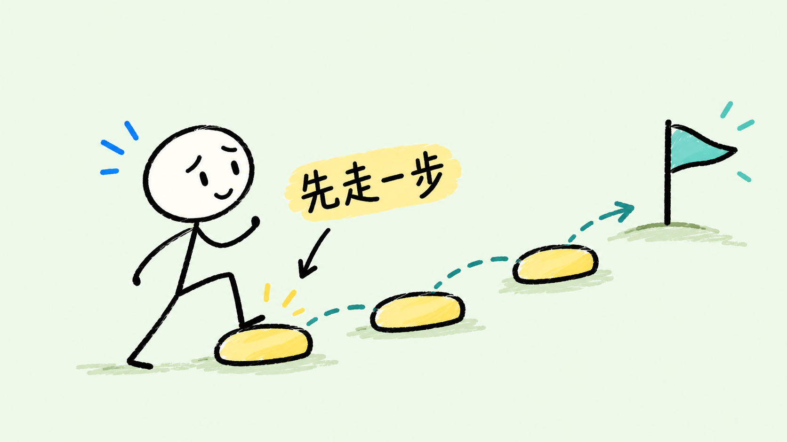
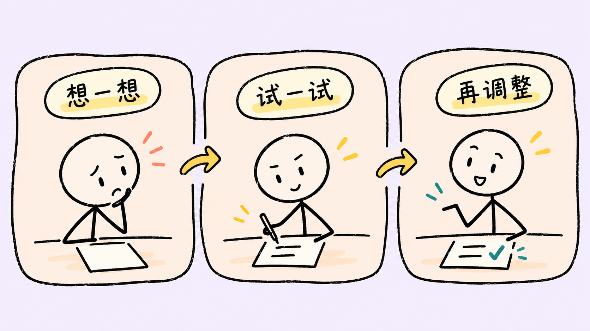

# Warm Stickfigure Illustrations

**温暖火柴人手绘配图 Skill** —— 把文章里的场景、情绪和知识关系，画成轻松、有趣、清楚的手绘插图。

线条火柴人 · 生动表情 · 柔和背景 · 协调亮色 · 中文手写感

## 它是什么

一个用于 Codex 的温暖火柴人手绘配图技能。先理解文章哪里值得画，再设计人物动作、关系和标注；支持只做方案、直接出图和局部改图。默认正文图16:9，也可以指定方形或竖版。

改编自 [Ian Xiaohei Illustrations](https://github.com/helloianneo/ian-xiaohei-illustrations)。保留内容理解与配图工作流，重新设计人物、背景、用色、表达气质和验收标准。详见 [NOTICE](NOTICE.md) 与 [LICENSE](LICENSE)。

## 效果图

以下图片为本项目实际生成示例，不是原作者作品，也不是手工绘制证明。实际结果仍需检查中文和画面。

### 先听我说


### 先走一步


### 信息太多，先选重点


### 接住再交棒


### 规则也包括我


### 想法落到纸上


### 好好说，认真听


### 试试，再调整


## 能做什么

- 为文章选择配图位置，输出简洁配图表。
- 为单个观点、关系、情绪或生活场景生成一张图。
- 为一篇文章生成多张独立、风格协调的图片。
- 编辑已有图的表情、文字、颜色或指定元素。

不把大量正文塞成课程海报，不承诺可编辑SVG/PPT源文件，也不伪造截图、数据和真实经历。

## 安装

只需要安装仓库内的 `warm-stickfigure-illustrations/` 子目录，不是把整个仓库当作Skill目录。

### Windows PowerShell

```powershell
git clone https://github.com/yijun-mai/warm-stickfigure-illustrations.git
$skillRoot = if ($env:CODEX_HOME) { Join-Path $env:CODEX_HOME 'skills' } else { Join-Path $env:USERPROFILE '.codex/skills' }
New-Item -ItemType Directory -Path $skillRoot -Force | Out-Null
$skillTarget = Join-Path $skillRoot 'warm-stickfigure-illustrations'
if (Test-Path -LiteralPath $skillTarget) { throw '目标技能已存在，请先比较版本，避免覆盖。' }
Copy-Item -LiteralPath './warm-stickfigure-illustrations/warm-stickfigure-illustrations' -Destination $skillTarget -Recurse
```

### macOS / Linux

```bash
git clone https://github.com/yijun-mai/warm-stickfigure-illustrations.git
skill_root="${CODEX_HOME:-$HOME/.codex}/skills"
mkdir -p "$skill_root"
test ! -e "$skill_root/warm-stickfigure-illustrations" || { echo 'Skill already exists; compare before replacing.'; exit 1; }
cp -R ./warm-stickfigure-illustrations/warm-stickfigure-illustrations "$skill_root/"
```

安装后在下一轮对话调用技能；若列表未刷新，可重新打开相关会话。

## 怎么用

```text
使用 $warm-stickfigure-illustrations，为这篇文章生成3张温暖火柴人手绘配图。
奶油和浅蓝背景、表情鲜明、简洁线条、中文短标注。每张独立输出。
【文章】
```

只要规划时，明确说“先不要生图”；只改图时，明确说明修改对象与保持项。更多可复制的调用见 [使用示例](examples/prompts.md)。

## 生成流程

阅读内容 → 选择值得画的位置 → 设计动作与情绪 → 单张生成 → 检查画面和中文 → 保存最终文件。

无需每次固定审批；用户明确只要方案时停在方案，明确要求生成时继续生成。通常最多额外修复2轮，仍不理想则说明问题，不无限重试。

内置图像工具可用时优先使用，不需要额外API密钥。没有图像工具时只能输出提示词，不能声称生成成功；不同工具中的效果可能不同。

## 目录

```text
README.md
LICENSE / NOTICE.md
examples/
  prompts.md
  images/                  实际生成展示图
warm-stickfigure-illustrations/
  SKILL.md
  agents/openai.yaml
  references/              风格、人物、构图、提示词与验收
  assets/examples/         按需加载的少量风格参考
  LICENSE / NOTICE.md
validation/                提示词与实际检查记录
scripts/                   项目完整性检查和技能打包
```

示例不是模板：新主题应重新安排动作与画面。仓库不包含原作者的小黑图片、二维码、用户文档、密钥或个人路径配置。

